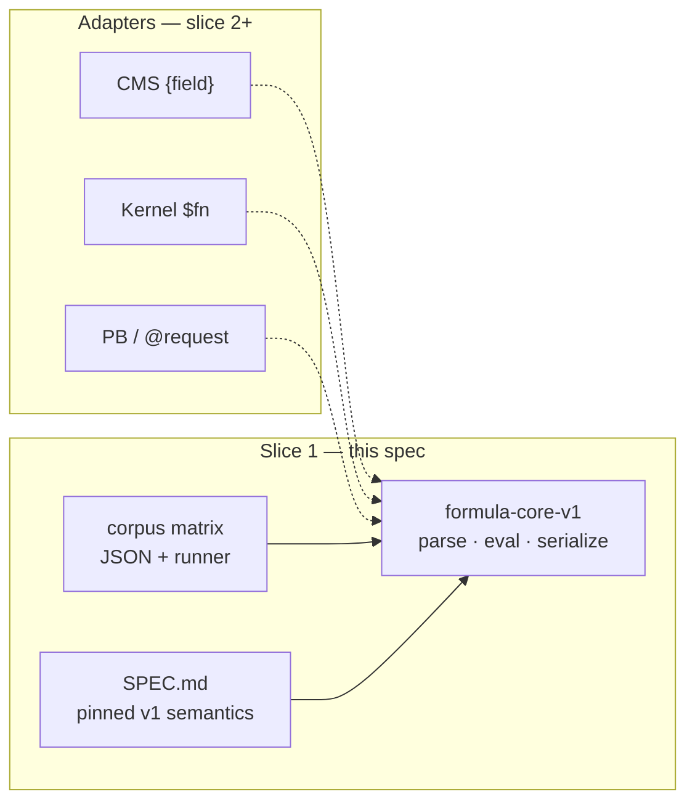

# TRL-472 — Spec: Frozen formula core v1 (corpus-first spike)

**Parent:** TRL-470 · **Impl:** TRL-473 · **ADR:** [0059](../../adr/0059-frozen-formula-core-dialect-adapters.md) · **Out of scope:** TRL-471 (pb-node), full surface adapter migration (slice 2)

## Context

ADR 0059 decides a single zero-dep **formula core** (tokenize / parse / evaluate / serialize) with **dialect adapters** at the edges. Shablon phase 4a (`lab/oss/shablon` @ `619a730`) classifies PB vs CMS-numeric expressions but does not evaluate through one engine.

This spec covers **slice 1 only**: incubate the core under `experiments/`, pin semantics in `SPEC.md`, and prove behavior via a **corpus runner** — before wiring `ExprEvaluator`, `trellis/cms`, or shablon proxy tests.

## Architecture



## Goal (slice 1)

Deliver a **testable spike** that:

1. Parses and evaluates a **frozen v1 subset** without `eval` / `new Function`.
2. Exposes a **canonical IR** with **round-trip** `parse → serialize → parse` stability for corpus cases.
3. Runs an **evaluation-equivalence matrix** (dialect tag × expression × context × expected).
4. Documents semantics (precision, coercion, identifier rules) in colocated `SPEC.md`.

## Module layout

| Path | Purpose |
| ---- | ------- |
| `experiments/formula-core-v1/index.ts` | Public API: `tokenize`, `parse`, `evaluate`, `serialize`, `parseAndEvaluate` |
| `experiments/formula-core-v1/ir.ts` | Canonical AST / IR types |
| `experiments/formula-core-v1/registry.ts` | Versioned function registry (v1 builtins) |
| `experiments/formula-core-v1/SPEC.md` | Frozen semantics contract |
| `experiments/formula-core-v1/corpus/matrix.jsonl` | One JSON object per row: `id`, `dialect`, `expr`, `context`, `expected`, `notes?` |
| `experiments/formula-core-v1/corpus/runner.test.ts` | Vitest: every row evaluates (or errors) as specified |

Add npm script:

```json
"formula-core-v1-unit": "vitest run experiments/formula-core-v1/corpus/runner.test.ts"
```

## v1 expression subset (minimum)

**Dialect tags in corpus** (adapter entrypoints may differ; core evaluates canonical IR):

| Tag | Source surface | v1 must include |
| --- | -------------- | ---------------- |
| `kernel-fn` | `ExprEvaluator` | `$mul`, `$add`, `$sub`, `$div`, `$if`, field refs `$name` |
| `cms-brace` | Trellis CMS | `{field}` refs, `+ - * / ( )`, numeric literals |
| `pb-compat` | shablon 4a fence | `@field` refs, same numeric ops as cms-numeric; **reject** rich (`concat`, string literals) at parse or classify |

**Context shape** (v1 minimal):

```ts
interface EvalContextV1 {
  record: Record<string, unknown>;
  request?: Record<string, unknown>; // for @request.* bindings when dialect=pb-compat
}
```

**Normalization (document in SPEC.md, implement for v1):**

- Missing field → `null` (or documented error policy per dialect row).
- JSON-LD single-element arrays unwrap one level before numeric ops.
- No graph-edge / rollup helpers in slice 1 (corpus rows tagged `deferred` are allowed as skipped tests).

## Security / determinism

- Core sources must not contain `eval(` or `new Function(` (enforced by unit test grep or lint script in corpus runner).
- Same `(expr, context)` → same result on Node LTS (deterministic; no `Date.now` in v1 builtins except explicit `$now` rows marked `skip` until slice 2).

## Non-goals (slice 1)

- Replacing `src/core/computation/expr-evaluator.ts` or `trellis/cms` client evaluator.
- Wiring shablon `pb-formula-compat-unit` to the core (slice 2).
- Museum-oss `=` leading syntax (corpus may list fixtures as `deferred`).
- npm export / `sync-trellis-core` pin (slice 2 after ADR 0059 acceptance).
- TRL-471 pb-node server.

## Slice 2 pointer (not this impl)

- Adapter modules: `kernel-fn`, `cms-brace`, `pb-compat` → IR.
- Shablon: delegate `classifyFormula` / future eval to core; keep `pb-formula-compat-unit` + `pb-schema-unit` green.
- Move graduated core from `experiments/` into package export (ADR §5).

## Acceptance criteria

**Spec (TRL-472):**

```text
test:test -f docs/issues/TRL-472/summary.md
test:npm run check
```

**Impl (TRL-473):**

```text
test:test -f experiments/formula-core-v1/SPEC.md
test:npm run formula-core-v1-unit
test:no eval/new Function in experiments/formula-core-v1/*.ts (grep gate)
```

Behavioral (verified by corpus, not separate AC):

- ≥12 corpus rows across all three dialect tags with at least one error/ reject row for `pb-compat` rich syntax.
- Round-trip: every `roundtrip: true` row survives `serialize(parse(expr))` unchanged.

## Impl hints

- Start from shablon `src/formula/dialect.js` rules for `pb-compat` reject matrix.
- Reuse naming from `ExprEvaluator` for kernel-fn builtins.
- Keep zero **runtime** deps in `experiments/formula-core-v1` (vitest dev-only).
