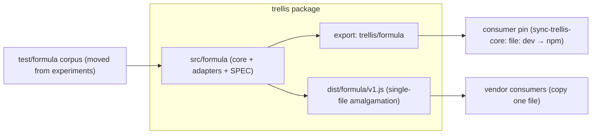

# TRL-478 — Spec: Formula core slice 3 (package export + amalgamation)

**Parent:** TRL-470 · **Impl:** TRL-479 · **Depends on:** TRL-476 (slice 2, closed; review TRL-477) · **ADR:** [0059](../../adr/0059-frozen-formula-core-dialect-adapters.md) §5 (accepted 2026-10-12)

## Context

Slices 1–2 incubated `experiments/formula-core-v1` (core + adapters + corpus + gates). ADR 0059 §5: the frozen artifact's home is the `trellis` package — "single-file amalgamation, zero runtime deps, Node LTS; propagated via the `trellis` package pin mechanism (`sync-trellis-core` precedent: file-link dev → npm pin). No fourth mechanism." The ADR is now Accepted; this slice graduates the spike.

## Architecture



## Goals

1. **Graduate source** — relocate `experiments/formula-core-v1/` → `src/formula/` (core, adapters, `SPEC.md`). Source of truth becomes the package; the experiments copy is removed.
2. **Package export** — add `"./formula"` to `package.json` exports (mirror `./cms` shape: `types` / `bun` / `import` → `dist/formula/index.*`); add `src/formula/index.ts` to the esbuild `build` entry list.
3. **Single-file amalgamation** — `scripts/build-formula-amalgamation.mjs` produces `dist/formula/v1.js` (esbuild bundle, ESM, `platform=node`, target node20 per `engines`, zero runtime deps). The script self-verifies: builds, dynamically imports the artifact, asserts `parse` / `evaluate` exports, exits non-zero otherwise. Wire as `build:formula` and chain into the main `build` script (main build starts with `rm -rf dist`).
4. **Tests relocate** — corpus runner + matrix → `test/formula/{runner.test.ts,matrix.jsonl}`; add `test/formula` to the `test` script; replace `formula-core-v1-unit` with `formula-unit` (new path).
5. **Gate cleanup** — drop the `check:experiments` chain and `tsconfig.experiments.json`; revert `check` to the plain build-config tsc (now covering `src/formula` via `src/**`); drop the `experiments/**` glob from `vitest.config.ts` includes.

## Move map

| From | To |
| ---- | -- |
| `experiments/formula-core-v1/{index,ir,parse,evaluate,serialize,registry,context}.ts` | `src/formula/…` |
| `experiments/formula-core-v1/adapters/` | `src/formula/adapters/` |
| `experiments/formula-core-v1/SPEC.md` | `src/formula/SPEC.md` |
| `experiments/formula-core-v1/corpus/{runner.test.ts,matrix.jsonl}` | `test/formula/…` |
| `package.json` scripts: `check:experiments`, `formula-core-v1-unit` | removed; `formula-unit`, `build:formula` added |
| `tsconfig.experiments.json` | removed |

## Non-goals (slice 3)

- Kernel `ExprEvaluator` / `trellis/cms` client migration (slice 4+; behavior-parity corpus still required).
- **Shablon import stays deferred/optional** — shablon has no `trellis` dependency today; adding one (file-link or npm) + delegating `classifyFormula` is a separate cross-repo wedge. This slice only makes it possible (export + amalgamation exist).
- npm publish / version bumps (ambient release flow), pb-node (TRL-471, parked).
- Changes to `sync-trellis-core` (none expected — it consumes the package, which now exports `./formula`).

## Acceptance criteria

**Spec (TRL-478):**

```text
test:test -f docs/issues/TRL-478/summary.md
test:npm run check
```

**Impl (TRL-479):**

```text
test:npm run check
test:npm run formula-unit
test:test -f src/formula/index.ts
test:sh -c "grep -rqE '(eval\(|new Function)' src/formula --include='*.ts' --exclude='*.test.ts' && exit 1 || exit 0"
test:node -e "const p=require('./package.json'); process.exit(p.exports['./formula']?0:1)"
test:node scripts/build-formula-amalgamation.mjs
test:cd ../../lab/oss/shablon && bun run pb-formula-compat-unit && bun run pb-schema-unit
```

## Impl hints

- Use `git mv` for the relocation (history); keep `SPEC.md` inside `src/formula/`.
- esbuild is already a devDependency — no new deps, runtime stays zero-dep.
- Self-reference smoke: `trellis/formula` resolves inside the repo via the exports map once `dist` exists; the amalgamation script is the fast, full build is heavy.
- AC runner cwd is the repo root; shablon paths are `cd ../../lab/oss/shablon` (pre-verified green: formula 4 pass, schema 6 pass).
- Do not touch `src/core/computation/expr-evaluator.ts` — parity migration is slice 4.
