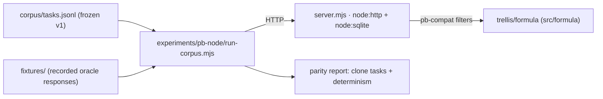

# TRL-489; Spec: pb-node clone spike; frozen subset + corpus gate

**Parent:** TRL-471 (spike, `needs-experiment`) · **Impl:** TRL-490 · **Experiment:** `[TRL-471/experiment.md](../TRL-471/experiment.md)` · **Corpus:** `TRL-471/corpus/tasks.jsonl` (v1, frozen 2026-10-12, 13 tasks) · **Refs:** ADR 0059 (core), ADR 0004 §7 (4d wire), ADR 0005 (file guards), brief `lab/oss/shablon/docs/handoff/pb-node-spike.md`

## Context

The experiment design is frozen: a zero-dep pure-Node PB-subset backend must pass the shablon conformance corpus with **oracle shape parity** on the clone arm. This spec turns that design into a build contract; **clone arm only**: the bridge storage variant (`v-bridge`) is a deferred follow-on (one variable at a time).n

## Architecture




## Goals

1. **Artifact**: `experiments/pb-node/`:
  - `server.mjs`; `node:http` + `node:sqlite`; collections schema, records CRUD, pb-compat filter via `trellis/formula` (relative import of `src/formula`), collection meta per ADR 0004 4d.
  - `SPEC.md`; the **frozen subset contract** (routes, shapes, guard semantics, non-goals, Node floor).
  - `package.json`; `{"type":"module","dependencies":{}}` (zero runtime deps; Node floor pinned in SPEC).
2. **Corpus runner**: `run-corpus.mjs` executes the frozen `TRL-471/corpus/tasks.jsonl`:
  - clone arms (`both`, `clone`) must pass with shape parity against `fixtures/` (recorded oracle responses);
  - `bridge` tasks are reported **deferred** (counted, not failed) this run;
  - **determinism**: run the corpus twice against one seeded db and require byte-identical GET bodies.
3. **Boot smoke**: `smoke-boot.mjs`: boots `server.mjs`, hits `GET /api/health`, asserts 200, exits.
4. **Adapter regression**: the shablon PB suites (`pb-schema-unit`, `pb-write-unit`, `pb-collection-meta-unit`) stay green unchanged (no adapter edits required by this spike).


## Deliverables


| Path                                 | Change                                        |
| ------------------------------------ | --------------------------------------------- |
| `experiments/pb-node/server.mjs`     | subset server (http + sqlite + core filters)  |
| `experiments/pb-node/SPEC.md`        | frozen subset contract                        |
| `experiments/pb-node/package.json`   | zero-dep, ESM                                 |
| `experiments/pb-node/run-corpus.mjs` | corpus runner + parity/determinism report     |
| `experiments/pb-node/smoke-boot.mjs` | boot smoke                                    |
| `experiments/pb-node/fixtures/**`    | recorded oracle responses for clone-arm tasks |
| `package.json` (repo)                | scripts: `pb-node-corpus`, `pb-node-boot`     |


## Non-goals

- `v-bridge` (Trellis storage); the follow-on hypothesis after the clone passes.
- Auth flows, multipart/file blobs, realtime SSE, admin UI (corpus exclusions).
- Promoting the artifact out of `experiments/` (no `src/` move, no publish).
- Editing the frozen corpus mid-run.


## Acceptance criteria

**Spec (TRL-489):**

```text
test:test -f docs/issues/TRL-489/summary.md
test:npm run check
```

**Impl (TRL-490):**

```text
test:npm run check
test:npm run pb-node-corpus
test:node -e "const p=require('./experiments/pb-node/package.json'); process.exit(Object.keys(p.dependencies||{}).length===0?0:1)"
test:node experiments/pb-node/smoke-boot.mjs
test:cd ../../lab/oss/shablon && bun run pb-schema-unit && bun run pb-write-unit && bun test server/pb-collection-meta.test.js
```


## Manual verify (reviewer/QA)

Point the shablon proxy at a live pb-node (`TRELLIS_CMS_URL` → `http://127.0.0.1:<port>`) and exercise a reads/writes smoke; the brief's "proxy tests pass unchanged against pb-node" exit criterion. Recorded here because it needs a running server and is not an AC.

## Impl hints

- `code` in `.mjs`, no build step; consume the frozen amalgamation `dist/formula/v1.js` (ADR 0059 §5 vendor path); the repo scripts chain `npm run build:formula`, so the artifact stays zero-dep.
- Record oracle fixtures once (real PocketBase, or documented constructed-from-oracle responses if PB is unavailable); commit them with the corpus; never generate expectations from pb-node.
- `node:sqlite` prints an experimental warning → SPEC.md pins the minimum Node floor; the runner tolerates the warning.
- Bridge-arm tasks must not be asserted in clone mode (tag-driven skipping), or the clone gate becomes self-referential.
- Keep the subset routes minimal; anything not exercised by the corpus is out of scope by default.

